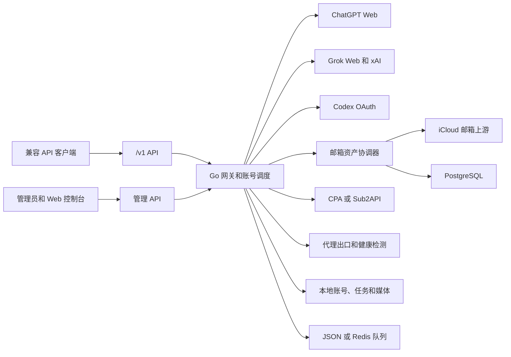

# GPTGrok2API Go

这是一个自托管的 OpenAI 兼容网关。本仓库基于 [lichao199208/gptGrok2api](https://github.com/lichao199208/gptGrok2api) 持续开发，当前版本为 `1.3.2-go`，代码以 `main` 分支为准。

项目通过网页协议和授权协议接入 ChatGPT、Codex 与 Grok，不是 OpenAI、ChatGPT 或 xAI 官方服务。上游接口、模型、账号策略和可用性会变化，请只使用你有权使用的账号，并自行承担账号、网络和内容风险。

## 功能

- OpenAI 兼容接口：Chat Completions、Responses、Anthropic Messages、搜索、文件、图片、视频和可编辑文件任务。
- ChatGPT Web：多模态对话、动态模型目录、能力额度、模型路由、浏览器环境和 Cookie 隔离、出口时区。
- 图片处理：`gpt-image-2` 生成/编辑、多参考图、mask、`background`、`output_format`、异步任务、结果筛选和有限重试。
- 账号池：JWT、OAuth refresh token、Grok SSO/OAuth、分组、额度预占、失败换号、限流冷却和并发控制。
- 账号维护：Session JSON 导入、重新登录进度、401 自动恢复、2FA 开启/续跑/TOTP 查看、账号清理。
- Codex：OAuth 多阶段授权、邮箱/2FA/手机号/SMS 验证、已有 2FA 复用、CPA 凭据导入、绑定和同步。
- 注册中心：ChatGPT Free 原生注册、iCloud 邮箱上游、验证码、注册失败补偿、定时批次和注册后自动开启 2FA。
- Grok 和代理：Grok Web/Console/Thinking/Imagine、视频、代理池/代理组/订阅、节点健康和可选 clearance 服务。
- 管理控制台：账号、注册、代理、图片图库、调用日志、参考图预览、实时监控、提示词、备份和系统设置。

删除账号时可以开启 iCloud 邮箱同步清理。系统先删除项目账号，再按保存的邮箱账号 ID 和邮箱地址查询上游别名并删除；清理失败会逐条报告，不会恢复已经删除的项目账号。

GPT 和 Grok 共用一层邮箱资产协调器。邮箱资产、平台占用、注册任务和清理结果保存在 PostgreSQL；同一个邮箱可以同时有 GPT 和 Grok 占用，只有最后一个占用释放后才允许删除上游别名。协调器保留邮箱来源 ID，注册失败补偿会复用原邮箱，账号删除会写入邮箱事件日志。`POST /api/icloud/reconcile` 可把已有 iCloud 邮箱和历史账号重新纳入登记，`GET /api/icloud/mailboxes` 与 `GET /api/icloud/events` 用于查看资产和操作历史。

代理池是可选项：注册和账号请求可以使用默认出口、单个代理或直连，也可以选择代理组。注册任务从代理组轮询分配节点，整个流程及补偿重试保持原节点；成功账号保存独立的出口绑定，后续对话、图片、视频及账号维护沿用它。已绑定账号不随默认出口配置变化，需在「代理管理 → 账号固定出口」填写原因后切换节点、单个代理或直连。节点被禁用、删除或 URL 改变时，旧绑定会报不可用，不会自动切换。

Resin 接入：在「代理管理」新建代理组，将节点类型设为「Resin（任务粘性出口）」，填写内网地址（如 `http://resin:2260`）、Platform 和代理 Token；注册页选择该代理组。应用在请求上游前自动生成并保存任务 Account，GPT/Grok 的整个注册流程、重试与补偿复用同一身份，注册成功后账号继续沿用。任务日志可查看 Platform 和 Account，不输出 Token。普通代理和直连不生成 Account；仅填写 Resin 地址的普通自定义代理不会自动启用此功能。Resin 节点失效、租约过期或供应商更换 IP 时仍可能变更出口，需设置覆盖任务周期的租约；这不保证物理 IP 永久不变。

每个节点的「注册任务并发」默认 1，GPT/Grok 共用容量；图片并发仍独立配置。注册分配采用轮询，不使用图片组的随机或时间窗口策略。注册限流/明确拒绝只对对应平台的注册用途暂停 15 分钟，不影响其他平台或已有账号调用。代理绑定按当前配置的节点 URL 校验，不能保证动态代理背后的公网 IP 不变；并发和暂停状态用于单主应用实例。

## 参考资料

- [CHANGELOG.md](./CHANGELOG.md)：版本和功能变更。
- [DEVELOPMENT.md](./DEVELOPMENT.md)：开发、构建和调试。
- [多模态聊天](./docs/multimodal-chat.md)：ChatGPT Web 图片输入、Responses 和流式边界。
- [图片 mask](./docs/image-mask.md)：图片编辑 mask 语义和限制。
- [ChatGPT Free 注册](./docs/registration/go-free.md)：iCloud 邮箱、浏览器环境、验证码和注册恢复。
- 基础项目：[lichao199208/gptGrok2api](https://github.com/lichao199208/gptGrok2api)，本仓库在其基础上持续开发。
- 协议和实现参考：[yukkcat/chatgpt2api](https://github.com/yukkcat/chatgpt2api)。
- 注册协议参考：[turb-gpt-free-register](https://github.com/myfanhua/turb-gpt-free-register) 的 protocol 流程、浏览器画像和 Sentinel 调用顺序。
- 图片参数参考：[OpenAI 图片编辑接口](https://developers.openai.com/api/reference/go/resources/images/methods/edit)。

ChatGPT、Codex 和 Grok 的登录与业务请求使用上游网页或授权协议。公开 API 文档只用于参数兼容参考，不能保证网页协议长期有效。

## 架构

GPT 和 Grok 是两条平行的能力链路，共用任务、日志、代理、媒体存储和管理界面，但不共用运行时账号池：

| 能力 | GPT 链路 | Grok Web 链路 |
| --- | --- | --- |
| 文本 | ChatGPT Web 多模态、动态模型和工具调用 | Grok Web Chat、Reasoning/Thinking、Console Responses |
| 媒体 | `gpt-image-2` 生成、编辑、mask 和异步任务 | Imagine 图片 Lite/普通/Pro、图片编辑、Imagine Video |
| 账号凭据 | `data/accounts.json`，由 GPT `accountPool` 调度 | `data/grok_accounts.json` 保存注册归档，`data/grok_runtime_accounts.json` 由 Grok `grokAccountPool` 调度 |
| 状态与额度 | GPT 账号校验、模型发现和额度刷新 | Grok SSO 探测、`rate-limits` 额度、运行时同步和独立失败冷却 |

模型路由先确定 provider，再选择对应账号池和协议客户端。这样 Grok SSO 不会被 GPT 的 JWT 校验、401 清理或模型发现误处理；GPT 账号也不会被 Grok 的媒体或 Console 请求选中。注册成功后，Grok SSO 只进入 Grok 运行时文件，账号管理页面仍通过独立的 Grok 标签页查看和操作。



## 快速启动

要求 Docker Engine 24+、Docker Compose v2 和可访问上游服务的网络出口。

```bash
git clone https://github.com/SkyKoo/gptGrok2api.git
cd gptGrok2api
cp .env.example .env
mkdir -p data logs
test -f config.json || printf '{}\n' > config.json
test -f data/auth_keys.json || printf '{"items":[]}\n' > data/auth_keys.json
```

编辑 `.env`，至少设置两个不同的随机密钥：

```dotenv
CHATGPT2API_AUTH_KEY=replace-with-a-long-random-api-key
CHATGPT2API_ADMIN_KEY=replace-with-a-different-admin-key
CHATGPT2API_PORT=3000
GO_PUBLIC_BASE_URL=https://your-domain.example
CFM_POSTGRES_PASSWORD=replace-with-a-long-random-password
```

启动默认 Go 服务、Redis 和 PostgreSQL：

```bash
docker compose up -d --build
docker compose ps
curl -fsS http://127.0.0.1:3000/health
```

控制台地址为 `http://服务器地址:3000/`。默认 Compose 不启动本地 iCloud 邮箱服务；使用仓库内服务时执行：

```bash
docker compose --profile local-icloud up -d --build
```

服务端的邮箱会话保存在 `data/icloud-privacy-mail/`。`ICLOUD_PRIVACY_MAIL_API_KEY` 只供后端访问，不要把邮箱管理接口暴露到公网。

需要独立图片队列时使用 `docker-compose.go.yml`。该文件的图片网关只监听 `127.0.0.1:3001`，并要求外部网络：

```bash
docker network inspect gptgrok2api_default >/dev/null 2>&1 || docker network create gptgrok2api_default
docker compose -f docker-compose.go.yml up -d --build
curl -fsS http://127.0.0.1:3000/health
```

服务器反向代理可以叠加 `deploy/docker-compose.server.yml`，它把服务绑定到 `127.0.0.1:8000`。该覆盖文件要求外部网络 `deploy_sub2api-network`；反向代理需要转发 `/`、`/v1`、`/api`、`/images`、`/files` 和 `/v1/files`，并支持 SSE、multipart 和长请求。

## API 用法

普通 API 使用 `CHATGPT2API_AUTH_KEY`，管理接口和控制台使用 `CHATGPT2API_ADMIN_KEY`。认证方式：

```http
Authorization: Bearer <api-key>
```

常用接口：

| 方法 | 路径 | 用途 |
| --- | --- | --- |
| `GET` | `/health` | 健康检查 |
| `GET` | `/v1/models` | 动态模型目录 |
| `POST` | `/v1/chat/completions` | 文本、多模态和工具调用 |
| `POST` | `/v1/responses` | Responses 兼容接口 |
| `POST` | `/v1/messages` | Anthropic Messages 兼容接口 |
| `POST` | `/v1/images/generations` | 图片生成 |
| `POST` | `/v1/images/edits` | 图片编辑和 mask |
| `POST` | `/api/image-tasks/generations` | 异步图片生成 |
| `GET` | `/api/image-tasks/{id}` | 查询异步任务 |
| `POST` | `/v1/videos` | 创建视频任务 |
| `GET` | `/v1/videos/{id}` | 查询视频任务 |
| `POST` | `/v1/editable-file-tasks` | 创建 PPT/PSD 等可编辑文件任务 |

文本聊天：

```bash
curl http://127.0.0.1:3000/v1/chat/completions \
  -H 'Authorization: Bearer your-api-key' \
  -H 'Content-Type: application/json' \
  -d '{"model":"auto","messages":[{"role":"user","content":"介绍一下这个项目"}]}'
```

图片编辑使用 multipart，可提交多个 `image` 字段：

```bash
curl http://127.0.0.1:3000/v1/images/edits \
  -H 'Authorization: Bearer your-api-key' \
  -F 'model=gpt-image-2' \
  -F 'prompt=保留主体，把背景改成蓝色' \
  -F 'image=@reference.png;type=image/png'
```

`gpt-image-2` 支持 `size`、`background` 和 `output_format`。同步接口返回 Base64；异步接口返回任务 ID，结果使用本站文件 URL。长任务建议使用异步接口，并确保反向代理等待时间足够。未列出的官方参数不代表已实现。

Grok Imagine 视频使用 `POST /v1/videos`，当前网页协议公开的时长为 6、10、15 秒；15 秒会按 10+5 秒分段请求。`size` 只决定宽高比，`resolution_name` 传递给上游，CFM 会原样保存上游返回的视频，不会自行转码，因此免费账号可能返回低于请求值的实际像素尺寸。Pro 生图、图片编辑和图生视频的上游限流会透传为 429，账号冷却只针对对应媒体能力。

常用管理入口：

- `/api/accounts`：账号导入、编辑、分组、删除、重新登录和 2FA。
- `/api/accounts/quotas/refresh`、`/api/accounts/models/refresh`：刷新账号额度和模型目录。
- `/api/accounts/codex/oauth/*`、`/api/accounts/codex/sync`：Codex 授权和 CPA 同步。
- `/api/register`、`/api/register/schedule`：注册、补偿和定时批次。
- `/api/logs`、`/api/images`、`/api/proxy/*`、`/api/backups`：日志、媒体、代理和备份。

## 账号和注册注意点

- Session JSON 导入只读取浏览器会话中的 Access Token、邮箱、用户 ID 和到期信息；不会自动得到原始 2FA 密钥或 Codex 凭据。
- 重新登录和 2FA 会复用账号保存的浏览器环境、设备标识、代理和邮箱配置；失败会保留原凭据，不会自动创建新账号或重新绑定验证器。
- Codex OAuth 会按上游实际要求执行邮箱、2FA、手机号和短信步骤；已保存的 2FA 密钥只在上游要求时使用。
- CPA 导入先预览再绑定，默认不覆盖已有凭据；邮箱或账户 ID 冲突时必须人工选择。
- 注册默认关闭定时启动和注册后自动 2FA。注册失败但邮箱已经创建时，补偿任务会复用原邮箱，不重复创建邮箱。
- GPT 和 Grok 注册必须先经过 PostgreSQL 邮箱资产协调器；数据库不可用时会停止注册，避免绕过资产登记直接创建上游别名。
- iCloud 邮箱上游只由后端访问。删除项目账号后的邮箱清理失败不会回滚项目账号删除，必须根据管理日志单独处理残留邮箱。
- 上游账号、模型、额度和邮箱协议会变化；健康检查通过只表示网关和依赖存活，不表示上游账号可用。

## 主要配置

| 变量 | 说明 |
| --- | --- |
| `CHATGPT2API_AUTH_KEY` | 普通 API 密钥。 |
| `CHATGPT2API_ADMIN_KEY` | 管理 API 和控制台密钥。 |
| `CHATGPT2API_WEBUI_KEY` | 可选的独立 Web UI 密钥。 |
| `CHATGPT2API_PORT` | 主 Compose 宿主机端口，默认 `3000`。 |
| `GO_PUBLIC_BASE_URL` | 图片、视频和文件的公开 HTTPS 前缀。 |
| `GO_CONFIG_PATH` | 运行时 JSON 配置，容器默认 `/app/data/config.json`。 |
| `GO_GROK_RUNTIME_ACCOUNTS_PATH` | Grok 运行时账号池文件，默认 `data/grok_runtime_accounts.json`；与 GPT `accounts.json` 分离。 |
| `GO_QUEUE_BACKEND` / `GO_REDIS_ADDR` | 队列类型和 Redis 地址；可选 `json` 或 `redis`。 |
| `GO_DATABASE_URL` | 邮箱资产协调器的 PostgreSQL 连接串；GPT/Grok 注册必须配置，未配置时仅可运行不依赖邮箱资产的兼容功能。 |
| `CFM_POSTGRES_DB` / `CFM_POSTGRES_USER` / `CFM_POSTGRES_PASSWORD` | Compose 内置 PostgreSQL 的数据库、用户和密码；生产环境请替换默认值。 |
| `GO_REQUEST_TIMEOUT_SECONDS` | 上游单请求超时，运行时限制 10–300 秒。 |
| `GO_CHAT_MAX_RETRIES` / `GO_CHAT_RETRY_CODES` | 聊天和图片常规换号重试配置。 |
| `GO_IMAGE_ACCOUNT_CONCURRENCY` / `GO_IMAGE_MAX_CONCURRENCY` | 图片单账号和单进程并发。 |
| `GO_IMAGE_RETENTION_DAYS` | 本地图片和视频保留天数。 |
| `GO_PROXY_URL` / `GO_PROXY_POOL` | 默认代理或逗号分隔的代理池。 |
| `GO_RESOURCE_PROXY_URL` / `GO_RESOURCE_PROXY_POOL` | 图片下载等资源请求的代理。 |
| `GO_ALLOW_ANONYMOUS` | 是否允许匿名 API，默认关闭。 |
| `GO_ALLOW_PRIVATE_IMAGE_URLS` | 是否允许读取内网图片地址，默认关闭。 |
| `ICLOUD_PRIVACY_MAIL_BASE_URL` / `ICLOUD_PRIVACY_MAIL_API_KEY` | iCloud 邮箱上游地址和后端访问密钥。 |
| `TZ` | 容器本地时区；业务请求时区按实际代理出口定位。 |

完整示例见 [.env.example](./.env.example)、[config.example.yaml](./config.example.yaml) 和 Compose 文件。`config.example.yaml` 是历史配置参考，Go 运行时保存的是 JSON；真实 `.env`、`config.json` 和 `data/` 不得提交。

## 数据、安全和升级

`data/` 包含账号 Token、Cookie、OAuth 凭据、注册恢复状态、模型目录、队列、日志和生成文件。至少备份 `data/`、`.env`、`config.json` 和反向代理配置；备份文件也要按凭据保护。

默认关闭匿名访问、私网图片 URL 和不受信任的 Host。生产环境使用 HTTPS，限制管理接口来源，不要把 Redis、图片网关或 iCloud 邮箱管理接口直接暴露到公网。

升级前排空注册、重新登录、2FA、图片和定时任务，备份后固定提交或镜像 digest 再切换；保留旧镜像作为回滚点。回滚只切换镜像和配置指针，不要用旧快照覆盖已经产生的新数据。维护期间使用维护标记暂停新的写入，验证完成后清除该标记。

## 开发和测试

```bash
go test ./...
go vet ./...
CGO_ENABLED=0 go build -trimpath -o gptgrok2api ./cmd/gptgrok2api

npm --prefix web-vue ci
npm --prefix web-vue run build
npm --prefix web-vue run test:session-import
npm --prefix web-vue run test:account-relogin
npm --prefix web-vue run test:cpa-binding
npm --prefix web-vue run test:registration-compensation
npm --prefix web-vue run test:registration-schedule
npm --prefix web-vue run test:log-images
npm --prefix web-vue run test:account-quotas
npm --prefix web-vue run test:account-edit
npm --prefix web-vue run test:account-progress-layout
```

Docker 使用 `Dockerfile` 或 `Dockerfile.golang` 构建 Go 后端和 Vue 前端，后端以 `CGO_ENABLED=0` 编译，ARM64 不需要额外 C 编译库。

## 许可证

请保留 [LICENSE](./LICENSE) 和 [GROK2API_LICENSE](./GROK2API_LICENSE)，并按其中条款使用和分发。
