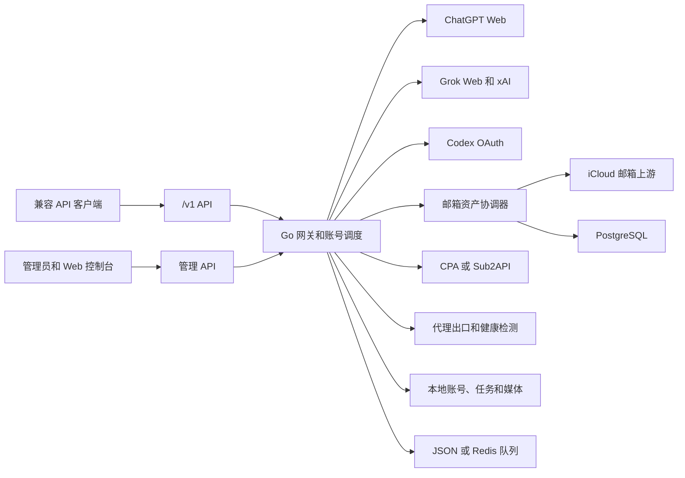

# GPTGrok2API Go

这是一个自托管的 OpenAI 兼容网关。本仓库基于 [lichao199208/gptGrok2api](https://github.com/lichao199208/gptGrok2api) 持续开发，当前版本为 `1.3.4-go`，代码以 `main` 分支为准。

项目通过网页协议和授权协议接入 ChatGPT、Codex 与 Grok，不是 OpenAI、ChatGPT 或 xAI 官方服务。上游接口、模型、账号策略和可用性会变化，请只使用你有权使用的账号，并自行承担账号、网络和内容风险。

## 功能

- OpenAI 兼容接口：Chat Completions、Responses、Anthropic Messages、搜索、文件、图片、视频和可编辑文件任务。
- ChatGPT Web：多模态对话、动态模型目录、能力额度、模型路由、浏览器环境和 Cookie 隔离、出口时区。
- 图片处理：`gpt-image-2` 生成/编辑、多参考图、mask、`background`、`output_format`、异步任务、结果筛选和有限重试。
- 账号池：JWT、OAuth refresh token、Grok SSO/OAuth、分组、额度预占、失败换号、限流冷却和并发控制。
- 账号维护：Session JSON 导入、重新登录进度、401 自动恢复、2FA 开启/续跑/TOTP 查看、账号清理。
- Grok 凭据失效：账号验证、额度刷新确认凭据无效时同步标记账号归档与运行池，文字、图片、视频统一跳过；普通刷新和同步入池不会解除异常或手动禁用，需显式验证成功后恢复。
- Grok 注册后校验：使用独立连接查询Fast额度，保留绑定代理与凭据，不复用其他请求的长期连接，也不自动重试403。失败在任务和账号管理中保留脱敏的上游状态/网络错误类别，账号维持待验证；复用已保存结果校验成功后启用账号，并在实际入池后标记“已加入”。
- 对话画图中的视频模式固定使用 `grok-imagine-video`，默认 6 秒、720p、竖屏，支持参考图；添加参考图保持视频模式。
- Codex：OAuth 多阶段授权、邮箱/2FA/手机号/SMS 验证、已有 2FA 复用、CPA 凭据导入、绑定和同步。
- 注册中心：ChatGPT Free 原生注册、iCloud 邮箱上游、验证码、注册失败补偿、定时批次和注册后自动开启 2FA。
- Grok 媒体额度与调度：生图统一使用 `grok-imagine-image-pro`，图片编辑保留 `grok-imagine-image-edit`，二者统一使用 `imagePro` 图片额度；视频统一720p，使用 `video720p` 额度。模型列表不再提供普通/Lite生图，旧模型名兼容升级到Pro，旧480p请求兼容升级到720p。媒体查询失败不影响文字凭据状态，零余额、次数未明确、缺失和失败分开显示。
- Grok 媒体额度查询使用独立连接，保留账号绑定代理、Cookie和原请求参数；不借用其他请求的长期连接。每次只发一个只读查询，不自动跟随重定向或在403后立即重试；记录请求/路由摘要与HTTP响应类型，不记录凭据或响应正文。
- Grok 媒体后台刷新：启动后60秒开始，每15秒扫描，每轮最多4个账号；快照有效期5分钟，待刷新/缺失/到达恢复时间时查询，每账号两次自动尝试至少间隔30秒；401/403/429失败自动退避15分钟，其他查询失败至少退避1分钟，手动刷新可提前执行一次，遵守维护标记。媒体请求前补查过期或缺失额度，只有明确足够的余额才选号；异常、禁用账号不参与。
- Grok 共享额度保护：图片按请求张数预占，视频按每段不超过6秒为1单位保守预占；这不是上游固定计价承诺。同一账号媒体请求串行，生图与编辑共用预占记录。请求发出前持久化预占及5分钟异常重启保护，正常结束后等待30秒结算再查询校准；手动刷新也不跨过进行中的请求或结算等待。上游缺失次数时不猜测无限额度，不足时不自动降级。视频流内限流/凭据/审核/中断按类型反馈，结果未知不自动重发。
- Grok 和代理：Grok Web/Console/Thinking/Imagine、视频、代理池/代理组/订阅、节点健康和可选 clearance 服务。
- xAI OAuth：提供 Grok 账号待授权列表、搜索与状态筛选；支持后台自动授权及备用手动设备码，按返回邮箱核对身份，授权后查询 OAuth 额度，并可同步到已配置的 CPA。
- 管理控制台：账号、注册、代理、图片图库、调用日志、参考图预览、实时监控、提示词、备份和系统设置。

删除账号时可以开启 iCloud 邮箱同步清理。系统先删除项目账号，再按保存的邮箱账号 ID 和邮箱地址查询上游别名并删除；清理失败会逐条报告，不会恢复已经删除的项目账号。

邮箱管理的操作日志显示完整邮箱地址，并单独标注资产 ID；历史日志会关联保留的邮箱资产，已同步删除上游的邮箱仍可追溯。

GPT 和 Grok 共用一层邮箱资产协调器。删除已注册账号后，对应平台永久标记为“已使用，待清理”，释放占用但禁止该平台再次注册（包括自动分配、补偿重试及手动启用）；另一平台独立保留。邮箱管理支持按此状态筛选，并沿用现有 HME 同步删除：其他平台仍有占用时不得删除上游邮箱。升级时仅依据明确的历史账号占用释放事件补记，普通注册失败释放不受影响。邮箱管理可分别禁用 GPT 或 Grok 注册，也可两者都禁用；旧版禁用状态兼容为两者都禁用。分配和补偿重试按目标渠道检查，仍按创建时间优先复用，没有可用资产时才向上游创建邮箱。渠道禁用不影响已有账号和收信，也不会触发上游删除。邮箱资产、平台占用、注册任务和清理结果保存在 PostgreSQL；同一个邮箱可以同时有 GPT 和 Grok 占用，只有最后一个占用释放后才允许删除上游别名。协调器保留邮箱来源 ID，注册失败补偿会复用原邮箱，账号删除会写入邮箱事件日志。`POST /api/icloud/reconcile` 可把已有 iCloud 邮箱和历史账号重新纳入登记，`GET /api/icloud/mailboxes` 与 `GET /api/icloud/events` 用于查看资产和操作历史。

xAI OAuth 账号列表的“后台授权”会将所选账号加入异步任务：服务端使用该账号已有 SSO，在隔离的 Grok Browser 会话中完成设备码和授权确认，再由 Go 后台取回 Token。保存前核对返回邮箱；缺失或不匹配时拒绝保存。同一账号的在途任务会复用，刷新页面可以恢复状态；服务中断、确认结果不明时不自动重放授权。SSO 无效、要求 MFA/人工验证或无法识别确认页时显示具体原因，手动设备码保留为备用入口。此流程使用账号的日常出口，未绑定时直连，不读取注册渠道代理；Worker 沿用 `grok.api_base/api_key`。任务和日志不保存 SSO、设备码或 Token。授权成功不等于拥有可用 OAuth 额度；授权任务完成和模型调用测试分别记录。

注册页的任务参数按 OpenAI、Grok 分别自动保存：任务模式、注册总数、线程数、目标额度/可用账号数、检查间隔、代理选择和 Resin 配置均独立。切换渠道恢复各自设置，刷新或重启后仍保留；旧版共用参数首次读取时复制为两套，之后互不覆盖。注册运行时可切换渠道，两边可同时运行；启停、清理历史、统计、日志、邮箱来源选择和定时批次分别属于各自渠道。切换只改变当前视图，不修改后台默认渠道，也不会停止另一边任务。请求必须通过 `?target=openai` 或 `?target=grok` 指定渠道，保存只更新本渠道；省略参数保留旧客户端默认渠道语义。自动与手动补偿读取原任务所属渠道的配置。来源连接和凭据仍由共享邮箱资产模块管理。旧 `openai_registration_schedule.json` 首次升级时固定为升级前默认渠道的定时器并保留触发时间，另一个渠道使用 `registration_extra_schedule.json`；文件中的 `target` 持久保存归属，后续切换不改绑。注册引擎目前仅支持按数量模式，独立保存不会新增额度/可用账号模式的执行能力。

代理池是可选项：注册和账号请求可以使用默认出口、单个代理或直连，也可以选择代理组。注册任务从代理组轮询分配节点，单次流程保持绑定，补偿创建子任务并按当前配置重新分配代理；GPT 成功账号保存注册出口绑定；Grok 注册任务保留注册代理记录，新注册账号入库后的日常调用默认绑定直连，覆盖文字、额度查询、生图、视频生成及文件下载。Grok 注册代理与日常调用出口分开，账号管理中的显式绑定仍可将日常调用改为指定代理。已绑定账号不随默认出口配置变化，需在「代理管理 → 账号固定出口」填写原因后切换节点、单个代理或直连。节点被禁用、删除或 URL 改变时，旧绑定会报不可用，不会自动切换。

Resin 接入：在注册页「注册代理」选择独立的「Resin 代理」，填写网关地址（如 `http://resin:2260`）、Platform 和代理 Token，无需新建代理组，也无需填写 Account。Account 按任务生成并在请求前保存，同一次注册尝试沿用绑定；GPT 成功账号继续沿用，Grok 新账号日常调用默认直连；补偿子任务生成新的 Account，仍保留原邮箱和重试链，不能保证分到不同节点；普通自定义代理不会自动附加 Account。Resin 自行管理内部节点，一个任务的上游拒绝只暂停该任务，不冻结整个渠道。旧版代理组里的 Resin 配置仍兼容已有绑定。任务身份稳定不代表物理 IP 永远不变，租约和故障切换仍由 Resin 管理。

每个节点的「注册任务并发」默认 1，GPT/Grok 共用容量；图片并发仍独立配置。注册分配采用轮询，不使用图片组的随机或时间窗口策略。注册限流/明确拒绝只对对应平台的注册用途暂停 15 分钟，不影响其他平台或已有账号调用。代理绑定按当前配置的节点 URL 校验，不能保证动态代理背后的公网 IP 不变；并发和暂停状态用于单主应用实例。

## 参考资料

- [CHANGELOG.md](./CHANGELOG.md)：版本和功能变更。
- [DEVELOPMENT.md](./DEVELOPMENT.md)：开发、构建和调试。
- [多模态聊天](./docs/multimodal-chat.md)：ChatGPT Web 图片输入、Responses 和流式边界。
- [图片 mask](./docs/image-mask.md)：图片编辑 mask 语义和限制。
- [ChatGPT Free 注册](./docs/registration/go-free.md)：iCloud 邮箱、浏览器环境、验证码和注册恢复。
- 基础项目：[lichao199208/gptGrok2api](https://github.com/lichao199208/gptGrok2api)，本仓库在其基础上持续开发。
- 协议和实现参考：[yukkcat/chatgpt2api](https://github.com/yukkcat/chatgpt2api)。
- 注册协议参考：[turb-gpt-free-register](https://github.com/myfanhua/turb-gpt-free-register) 的 protocol 流程、浏览器画像和 Sentinel 调用顺序。
- 图片参数参考：[OpenAI 图片编辑接口](https://developers.openai.com/api/reference/go/resources/images/methods/edit)。

ChatGPT、Codex 和 Grok 的登录与业务请求使用上游网页或授权协议。公开 API 文档只用于参数兼容参考，不能保证网页协议长期有效。

## 架构

GPT 和 Grok 是两条平行的能力链路，共用任务、日志、代理、媒体存储和管理界面，但不共用运行时账号池：

| 能力 | GPT 链路 | Grok Web 链路 |
| --- | --- | --- |
| 文本 | ChatGPT Web 多模态、动态模型和工具调用 | Grok Web Chat、Reasoning/Thinking、Console Responses |
| 媒体 | `gpt-image-2` 生成、编辑、mask 和异步任务 | Imagine 图片 Lite/普通/Pro、图片编辑、Imagine Video |
| 账号凭据 | `data/accounts.json`，由 GPT `accountPool` 调度 | `data/grok_accounts.json` 保存注册归档，`data/grok_runtime_accounts.json` 由 Grok `grokAccountPool` 调度 |
| 状态与额度 | GPT 账号校验、模型发现和额度刷新 | Grok SSO 探测、`rate-limits` 额度、运行时同步和独立失败冷却 |

模型路由先确定 provider，再选择对应账号池和协议客户端。这样 Grok SSO 不会被 GPT 的 JWT 校验、401 清理或模型发现误处理；GPT 账号也不会被 Grok 的媒体或 Console 请求选中。注册成功后，Grok SSO 只进入 Grok 运行时文件，账号管理页面仍通过独立的 Grok 标签页查看和操作。管理员的 Grok 列表和卡片完整展示邮箱与账号 ID，长内容换行显示；密码、SSO、Cookie 等凭据仍不在账号列表接口返回。



## 快速启动

要求 Docker Engine 24+、Docker Compose v2 和可访问上游服务的网络出口。

```bash
git clone https://github.com/SkyKoo/gptGrok2api.git
cd gptGrok2api
cp .env.example .env
mkdir -p data logs
test -f config.json || printf '{}\n' > config.json
test -f data/auth_keys.json || printf '{"items":[]}\n' > data/auth_keys.json
```

编辑 `.env`，至少设置两个不同的随机密钥：

```dotenv
CHATGPT2API_AUTH_KEY=replace-with-a-long-random-api-key
CHATGPT2API_ADMIN_KEY=replace-with-a-different-admin-key
CHATGPT2API_PORT=3000
GO_PUBLIC_BASE_URL=https://your-domain.example
CFM_POSTGRES_PASSWORD=replace-with-a-long-random-password
```

启动默认 Go 服务、Redis 和 PostgreSQL：

```bash
docker compose up -d --build
docker compose ps
curl -fsS http://127.0.0.1:3000/health
```

控制台地址为 `http://服务器地址:3000/`。默认 Compose 不启动本地 iCloud 邮箱服务；使用仓库内服务时执行：

```bash
docker compose --profile local-icloud up -d --build
```

服务端的邮箱会话保存在 `data/icloud-privacy-mail/`。`ICLOUD_PRIVACY_MAIL_API_KEY` 只供后端访问，不要把邮箱管理接口暴露到公网。

需要独立图片队列时使用 `docker-compose.go.yml`。该文件的图片网关只监听 `127.0.0.1:3001`，并要求外部网络：

```bash
docker network inspect gptgrok2api_default >/dev/null 2>&1 || docker network create gptgrok2api_default
docker compose -f docker-compose.go.yml up -d --build
curl -fsS http://127.0.0.1:3000/health
```

服务器反向代理可以叠加 `deploy/docker-compose.server.yml`，它把服务绑定到 `127.0.0.1:8000`。该覆盖文件要求外部网络 `deploy_sub2api-network`；反向代理需要转发 `/`、`/v1`、`/api`、`/images`、`/files` 和 `/v1/files`，并支持 SSE、multipart 和长请求。

## 对话画图与 OAuth 的使用范围

2026-11-02 确认：对话画图暂时只接入 Web 端能力。GPT 对话和图片使用 ChatGPT Web，Grok 对话、图片和视频使用 Grok Web / SSO；模型列表按各自 Web 目录与账号权限展示。对话画图当前未接入 Codex OAuth 推理通道，也暂不新增 xAI OAuth 推理通道。

CFM 保留 Codex OAuth 和 xAI OAuth 的授权、凭据管理及 CPA 同步能力；两类 OAuth 的后续模型使用与调用验证统一通过 CPA 进行。`grok-4.5` 等 OAuth 模型是否可用，在 CPA 中验证，不据此加入 Web 模型列表。CPA 接收凭据与实际模型调用成功分别验收。

## Grok Web 对话模型目录

Grok 网页端通过 `POST /rest/modes` 提供模式、中文名称、描述和账号权限。CFM 使用稳定的 `grok-web-auto`、`grok-web-fast`、`grok-web-expert`、`grok-web-heavy` ID；请求向上游发送对应的 `modeId`，页面和 `/v1/models` 的 `name` 显示官方描述，不把模式固定标成某个版本。2026-11-02 读取的公开目录中，Expert / Heavy 描述为 Grok 4.7；这只是当时的官方描述，不等于每个账号都具备使用权限，也不能证明 Web 可指定 `grok-4.5`。OAuth / CLI 的模型验证属于另一条通道。

服务使用各账号现有 Cookie 和调用出口读取目录，不生成内容。目录缓存6小时；后台沿用启动2分钟后、每15秒扫描的节奏，每轮最多刷新2个账号。首次读取模型列表可补查1个账号；请求所需模式没有已确认可用账号时，最多补查2个到期账号。单次目录请求超时12秒，不跟随重定向、不自动重试；失败退避15分钟。缓存过期时不再显示其版本说明，也不凭旧权限发起调用。可用 `GO_GROK_MODES_URL` 指定测试目录接口。

账号只有在官方 `availability.available` 明确存在、目录仍新鲜且未被禁用或判为凭据异常时才可调度；`requiresUpgrade`、`unavailable`、`comingSoon` 和未知权限均排除。已知耗尽且未到重置时间的对应模式额度也会排除，Fast 余额不能代替 Expert 余额；目录权限查询不返回精确余量，文字额度仍以既有额度查询及实际请求反馈为准。目录401同步标记凭据异常；403、429及网络错误不会被误判为凭据失效。目录接口成功不代表已经完成真实模型生成测试。

旧 `grok-4.20-*` 及 `grok-4.3-fast` 名称保留为 Web 模式兼容别名，但不再出现在聊天模型列表中；响应返回规范的 `grok-web-*` ID，不承诺固定旧版本。页面保存的旧选择会迁移到对应模式。缺少当前官方目录依据的 `grok-4.3-beta` 不再提供。Console 模型和 xAI OAuth 测试保持各自通道。

## xAI OAuth 额度与 CPA 同步

在“OAuth 接入”中，后台授权、手动设备码或凭据导入成功后，会查询一次 xAI CLI 的 `/billing`，不以发送模型请求来查询余额。已有授权可逐账号点击“刷新额度”；若 Access Token 已过期且存在 Refresh Token，会先刷新凭据再读取额度。仅刷新列表不会向上游查询余额。

2026-11-02 实测的 billing 数据位于 `config.monthlyLimit.val`、`config.used.val`、`config.onDemandCap.val`，账期来自 `billingPeriodStart` / `billingPeriodEnd`；同时兼容旧版 `creditUsagePercent`。同日对指定账号进行真实验证：`/billing` 月度/按量上限均为 0，修正 CLI 请求头后 `grok-4.5 /responses` 仍返回 200/completed。因此显示“月度额度 0 · 可用总量未知”，不从 billing 零值推断无调用权限，也不显示虚假的 100%。账期结束不承诺届时增加额度。缺字段显示“上游未提供”，HTTP/解析错误显示“查询失败”及具体原因。授权状态、OAuth 余额、凭据到期时间分别展示；OAuth 余额不代表 SSO 图片或视频余额。

CPA 使用“账号导入”中已有的连接配置：在 OAuth 页选择“CPA 同步目标”，再点击账号行的“同步 CPA”。服务端按 CPA xAI 格式上传 `xai-<邮箱>.json`（`type=xai`、`auth_kind=oauth`），文件包含 OAuth 凭据和到期时间，不包含 SSO。上传前核对同名文件的渠道和邮箱，上传后再次确认 CPA 已识别；只有确认成功才显示“已同步”。失败显示脱敏原因，不自动重试上传。重新授权或刷新令牌后会提示“凭据已更新，待同步”，需重新同步 CPA。

上述同步是逐账号操作；授权成功不自动上传到 CPA。CFM 保存一个账号最近一次同步的目标及结果，切换目标后需再次点击同步。同步成功表示 CPA 接收了凭据，不代表账号有可用额度或已完成真实模型调用。

## API 用法

普通 API 使用 `CHATGPT2API_AUTH_KEY`，管理接口和控制台使用 `CHATGPT2API_ADMIN_KEY`。认证方式：

```http
Authorization: Bearer <api-key>
```

常用接口：

| 方法 | 路径 | 用途 |
| --- | --- | --- |
| `GET` | `/health` | 健康检查 |
| `GET` | `/v1/models` | 动态模型目录 |
| `POST` | `/v1/chat/completions` | 文本、多模态和工具调用 |
| `POST` | `/v1/responses` | Responses 兼容接口 |
| `POST` | `/v1/messages` | Anthropic Messages 兼容接口 |
| `POST` | `/v1/images/generations` | 图片生成 |
| `POST` | `/v1/images/edits` | 图片编辑和 mask |
| `POST` | `/api/image-tasks/generations` | 异步图片生成 |
| `GET` | `/api/image-tasks/{id}` | 查询异步任务 |
| `POST` | `/v1/videos` | 创建视频任务 |
| `GET` | `/v1/videos/{id}` | 查询视频任务 |
| `POST` | `/v1/editable-file-tasks` | 创建 PPT/PSD 等可编辑文件任务 |

文本聊天：

```bash
curl http://127.0.0.1:3000/v1/chat/completions \
  -H 'Authorization: Bearer your-api-key' \
  -H 'Content-Type: application/json' \
  -d '{"model":"auto","messages":[{"role":"user","content":"介绍一下这个项目"}]}'
```

图片编辑使用 multipart，可提交多个 `image` 字段：

```bash
curl http://127.0.0.1:3000/v1/images/edits \
  -H 'Authorization: Bearer your-api-key' \
  -F 'model=gpt-image-2' \
  -F 'prompt=保留主体，把背景改成蓝色' \
  -F 'image=@reference.png;type=image/png'
```

`gpt-image-2` 支持 `size`、`background` 和 `output_format`。同步接口返回 Base64；异步接口返回任务 ID，结果使用本站文件 URL。长任务建议使用异步接口，并确保反向代理等待时间足够。未列出的官方参数不代表已实现。

Grok Pro 生图通过 SSO WebSocket 的 `resolution_name` 请求 `1k` / `2k` 档位，并按 `n` 传递 `num_generations`；`size` 同时映射比例和分辨率档位（例如 `2048x2048`、`2560x1440` 请求 2K），不保证精确输出像素。2026-11-02 实测当前账号的 2K 请求被上游以 Invalid argument 拒绝，尚未确认是账号权限还是接口参数限制；对话画图暂仅提供自动/1K，API 显式 2K 请求被拒绝时返回明确中文错误，不自动降级或重发。CFM 等待每张图片的 `completed` 终态后优先下载最终资源，验证真实图片内容并原样保存；不再按文件大小或 JPEG 扩展名把预览当作完成图。支持实际使用的 `imagine-public.x.ai` 公共原图域名，下载不携带 SSO/Cookie，也不跟随重定向；其他原图仍限于已知 Grok 域名。原图下载失败不会回退到预览。Grok 编辑仍使用原编辑协议，本次不增加编辑的 2K 选项。

Grok Imagine 视频使用 `POST /v1/videos`，当前网页协议公开的时长为 6、10、15 秒；15 秒会按 10+5 秒分段请求。`size` 只决定宽高比，`resolution_name` 传递给上游，CFM 会原样保存上游返回的视频，不会自行转码，因此免费账号可能返回低于请求值的实际像素尺寸。Pro 生图、图片编辑和图生视频的上游限流会透传为 429，账号冷却只针对对应媒体能力。

常用管理入口：

- `/api/accounts`：账号导入、编辑、分组、删除、重新登录和 2FA。
- `/api/accounts/quotas/refresh`、`/api/accounts/models/refresh`：刷新账号额度和模型目录。
- `/api/accounts/codex/oauth/*`、`/api/accounts/codex/sync`：Codex 授权和 CPA 同步。
- `/api/register`、`/api/register/schedule`：注册、补偿和定时批次。
- `/api/logs`、`/api/images`、`/api/proxy/*`、`/api/backups`：日志、媒体、代理和备份。

## 账号和注册注意点

- Session JSON 导入只读取浏览器会话中的 Access Token、邮箱、用户 ID 和到期信息；不会自动得到原始 2FA 密钥或 Codex 凭据。
- 重新登录和 2FA 会复用账号保存的浏览器环境、设备标识、代理和邮箱配置；失败会保留原凭据，不会自动创建新账号或重新绑定验证器。
- Codex OAuth 会按上游实际要求执行邮箱、2FA、手机号和短信步骤；已保存的 2FA 密钥只在上游要求时使用。
- CPA 导入先预览再绑定，默认不覆盖已有凭据；邮箱或账户 ID 冲突时必须人工选择。
- 注册默认关闭定时启动和注册后自动 2FA。失败后保留原邮箱；GPT 只对临时错误自动补偿，Grok 当前需手动重试。每次补偿创建独立子任务，保留原记录并沿链累计自动补偿次数，已有冷却不因新任务而提前结束。上游明确拒绝或安全验证未完成时，先核查原因，不自动重试。
- GPT 和 Grok 注册必须先经过 PostgreSQL 邮箱资产协调器；数据库不可用时会停止注册，避免绕过资产登记直接创建上游别名。
- iCloud 邮箱上游只由后端访问。删除项目账号后的邮箱清理失败不会回滚项目账号删除，必须根据管理日志单独处理残留邮箱。
- 上游账号、模型、额度和邮箱协议会变化；健康检查通过只表示网关和依赖存活，不表示上游账号可用。

## 主要配置

| 变量 | 说明 |
| --- | --- |
| `CHATGPT2API_AUTH_KEY` | 普通 API 密钥。 |
| `CHATGPT2API_ADMIN_KEY` | 管理 API 和控制台密钥。 |
| `CHATGPT2API_WEBUI_KEY` | 可选的独立 Web UI 密钥。 |
| `CHATGPT2API_PORT` | 主 Compose 宿主机端口，默认 `3000`。 |
| `GO_PUBLIC_BASE_URL` | 图片、视频和文件的公开 HTTPS 前缀。 |
| `GO_CONFIG_PATH` | 运行时 JSON 配置，容器默认 `/app/data/config.json`。 |
| `GO_GROK_RUNTIME_ACCOUNTS_PATH` | Grok 运行时账号池文件，默认 `data/grok_runtime_accounts.json`；与 GPT `accounts.json` 分离。 |
| `GO_QUEUE_BACKEND` / `GO_REDIS_ADDR` | 队列类型和 Redis 地址；可选 `json` 或 `redis`。 |
| `GO_DATABASE_URL` | 邮箱资产协调器的 PostgreSQL 连接串；GPT/Grok 注册必须配置，未配置时仅可运行不依赖邮箱资产的兼容功能。 |
| `CFM_POSTGRES_DB` / `CFM_POSTGRES_USER` / `CFM_POSTGRES_PASSWORD` | Compose 内置 PostgreSQL 的数据库、用户和密码；生产环境请替换默认值。 |
| `GO_REQUEST_TIMEOUT_SECONDS` | 上游单请求超时，运行时限制 10–300 秒。 |
| `GO_CHAT_MAX_RETRIES` / `GO_CHAT_RETRY_CODES` | 聊天和图片常规换号重试配置。 |
| `GO_IMAGE_ACCOUNT_CONCURRENCY` / `GO_IMAGE_MAX_CONCURRENCY` | 图片单账号和单进程并发。 |
| `GO_IMAGE_RETENTION_DAYS` | 本地图片和视频保留天数。 |
| `GO_PROXY_URL` / `GO_PROXY_POOL` | 默认代理或逗号分隔的代理池。 |
| `GO_RESOURCE_PROXY_URL` / `GO_RESOURCE_PROXY_POOL` | 图片下载等资源请求的代理。 |
| `GO_ALLOW_ANONYMOUS` | 是否允许匿名 API，默认关闭。 |
| `GO_ALLOW_PRIVATE_IMAGE_URLS` | 是否允许读取内网图片地址，默认关闭。 |
| `ICLOUD_PRIVACY_MAIL_BASE_URL` / `ICLOUD_PRIVACY_MAIL_API_KEY` | iCloud 邮箱上游地址和后端访问密钥。 |
| `TZ` | 容器本地时区；业务请求时区按实际代理出口定位。 |

完整示例见 [.env.example](./.env.example)、[config.example.yaml](./config.example.yaml) 和 Compose 文件。`config.example.yaml` 是历史配置参考，Go 运行时保存的是 JSON；真实 `.env`、`config.json` 和 `data/` 不得提交。

## 数据、安全和升级

`data/` 包含账号 Token、Cookie、OAuth 凭据、注册恢复状态、模型目录、队列、日志和生成文件。至少备份 `data/`、`.env`、`config.json` 和反向代理配置；备份文件也要按凭据保护。

默认关闭匿名访问、私网图片 URL 和不受信任的 Host。生产环境使用 HTTPS，限制管理接口来源，不要把 Redis、图片网关或 iCloud 邮箱管理接口直接暴露到公网。

升级前排空注册、重新登录、2FA、图片和定时任务，备份后固定提交或镜像 digest 再切换；保留旧镜像作为回滚点。回滚只切换镜像和配置指针，不要用旧快照覆盖已经产生的新数据。维护期间使用维护标记暂停新的写入和图片到期清理，验证完成后清除该标记；清理调度检测到维护结束后，继续按原保留期处理到期图片和终态任务。

## 开发和测试

```bash
go test ./...
go vet ./...
CGO_ENABLED=0 go build -trimpath -o gptgrok2api ./cmd/gptgrok2api

npm --prefix web-vue ci
npm --prefix web-vue run build
npm --prefix web-vue run test:session-import
npm --prefix web-vue run test:account-relogin
npm --prefix web-vue run test:cpa-binding
npm --prefix web-vue run test:registration-compensation
npm --prefix web-vue run test:registration-schedule
npm --prefix web-vue run test:log-images
npm --prefix web-vue run test:account-quotas
npm --prefix web-vue run test:account-edit
npm --prefix web-vue run test:account-progress-layout
```

Docker 使用 `Dockerfile` 或 `Dockerfile.golang` 构建 Go 后端和 Vue 前端，后端以 `CGO_ENABLED=0` 编译，ARM64 不需要额外 C 编译库。

## 许可证

请保留 [LICENSE](./LICENSE) 和 [GROK2API_LICENSE](./GROK2API_LICENSE)，并按其中条款使用和分发。

### Grok 账号列表的数据含义

账号管理的创建时间来自 CFM 首次保存账号记录的 `created_at`，导入账号为入库时间。最近调用与成功/失败次数来自 Grok 调用池已记录的请求结果（含重试、参考图上传，不含额度查询和登录验证）；历史未记录数据不补算，显示“暂无记录”。调用统计采用内存更新与合并落盘。账号管理仅保留 OAuth 状态，OAuth 额度与重置周期统一放在 OAuth 接入页，分别显示“待查询”“上游未提供”或“查询失败”。“加入调用池/同步调用池”同步现有 SSO 和配置供请求调度，不重新注册、不执行登录验证，也不解除异常或禁用状态。


## Grok 浏览器会话队列

注册、后台 xAI OAuth 及旧版 Turnstile/SSO 浏览器路径共用 Worker 的 FIFO 队列。`GROK_BROWSER_CONCURRENCY` 默认 1，必须与实际许可容量匹配；当前单进程 Worker 保持一个队列，不能通过增加 Uvicorn worker 数突破许可。注册从浏览器启动到最终关闭持续占有名额，OAuth 在浏览器准备完成后才申请设备码。

页面等待阶段显示“等待浏览器会话释放”，启动阶段显示“正在启动浏览器”。只对启动前明确的 `session limit reached` 等待 240 秒后再次尝试启动；不重放注册、验证码或 OAuth 确认操作。浏览器队列最多等待 8 分钟，之后返回等待超时。注册还受原任务整体超时约束。Go 每秒查询同一预约；取消、等待超时或启动响应丢失会请求释放，失联预约 45 秒过期，未关闭的活动浏览器最多保留 20 分钟。关闭操作单次最多等待 8 秒；超时或异常时继续占有名额，后台清理确认关闭后才放行。关闭长期无法确认时需检查 Worker，健康接口的 capacity 会保持 0。

新版 app 与 grok-browser 必须一起发布（新增内部浏览器预约接口及 browser_sessions.py）；旧 Worker 会拒绝预约，应用给出明确浏览器准备错误。日常 OAuth 的直连/账号绑定路由和注册环境参数各自保留。

CLI 额度查询与调用使用当前协议请求头，默认版本 `1.0.70`（2026-11-02 验证）；必要时可设置 `CFM_XAI_CLI_CLIENT_VERSION` 为有效的三段版本号。HTTP 426 属于客户端协议不兼容，403 表示权限拒绝，均不能直接当成零额度或凭据失效。对 403 不自动刷新凭据并重放调用。CPA 同步仅传递凭据；本次直接上游调用成功证明该账号当时可用，实际总量及是否消耗某项共享权益仍未由 billing 返回。
